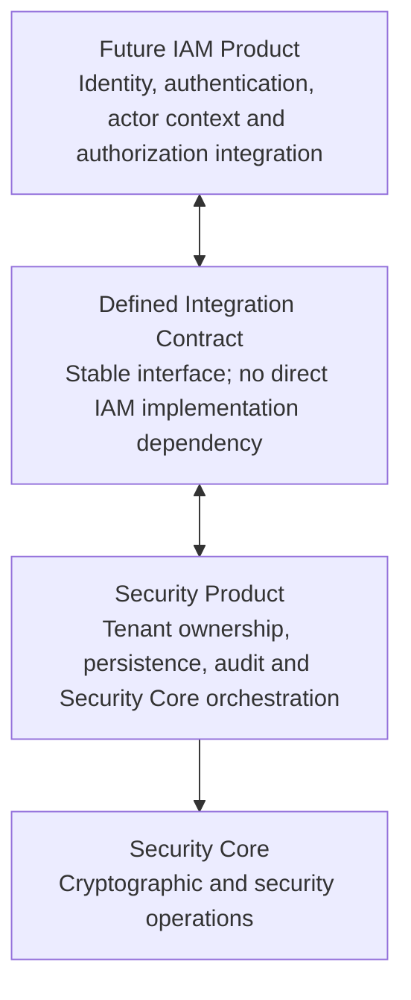

## Phase 11.2.8 — Define Future IAM Integration Boundary.

We’ll keep this step strictly within the current TraceMind roadmap. Since the Security Core and Security Product boundaries are already established and verified, this substep will define how a future IAM product can integrate with Security Product without creating a dependency on IAM today.

# Target Boundary

## Architecture



## Component Responsibilities

| Component                        | Responsibility                                                                     |
| -------------------------------- | ---------------------------------------------------------------------------------- |
| **Future IAM Product**           | Identity, authentication, actor context and authorization integration.             |
| **Defined Integration Contract** | Provides a stable interface without a direct dependency on the IAM implementation. |
| **Security Product**             | Owns tenant ownership, persistence, audit and Security Core orchestration.         |
| **Security Core**                | Performs cryptographic and security operations.                                    |

## Boundary Principle

The Security Product integrates with the future IAM Product through a defined, stable contract. It must not depend directly on IAM implementation details.

The Security Product owns tenant-aware persistence and audit, and orchestrates security operations through Security Core.
**Boundary rules**

- Authentication identifies the actor; IAM authorization determines whether that actor may perform an operation.
- Security Product must not implement its own competing IAM engine.
- Security Product must not import future IAM implementation classes or depend on src/modules/iam/.
- Tenant resource ownership remains a separate check; IAM permission does not replace tenant hierarchy validation.
- Subscription entitlements determine whether a feature is available; they do not grant an actor permission to use it.
- Until IAM exists, the integration contract must not require an IAM server, database, SDK, or runtime initialization.

### 11.2.8.1 — Define the IAM contract

- We’ll add a contract only—no IAM implementation, database, authentication middleware, or runtime dependency. The contract will let Security Product request an authorization decision from a future IAM adapter while keeping tenant ownership as a separate responsibility.

File 1 — `src/modules/security-product/application/interfaces/future-iam.port.ts`
File 2 — `src/modules/security-product/__tests__/future-iam.port.spec.ts`
File 3 — `src/modules/security-product/__tests__/future-iam.port.manual.ts`
File 4 — Update `src/modules/security-product/index.ts`

### 11.2.8.2 — Verification

Run the focused tests first, then the broader checks from the project root, `D:\Rahul\Rahul\v2\TraceMind.`

```js
npx vitest run src/modules/security-product/__tests__/future-iam.port.spec.ts
npx tsx src/modules/security-product/__tests__/future-iam.port.manual.ts
npm run test:security
npm run test:security:manual
npm run type-check
npm run build
```

### Acceptance checklist

```js
- [ ] IAM integration is defined by a public TypeScript contract only.
- [ ] Actor identity, action, resource and tenant scope can be passed through the contract.
- [ ] Allowed and denied decisions are preserved.
- [ ] No IAM implementation, database, authentication middleware or runtime dependency is introduced.
- [ ] Existing Security Product and Security Core behavior remains unchanged.
- [ ] Focused tests, manual checks, security tests, type-check and build all pass.
```

**Important**: These tests verify the contract using a mock adapter; they do not prove a real IAM authorization system exists or is secure.
