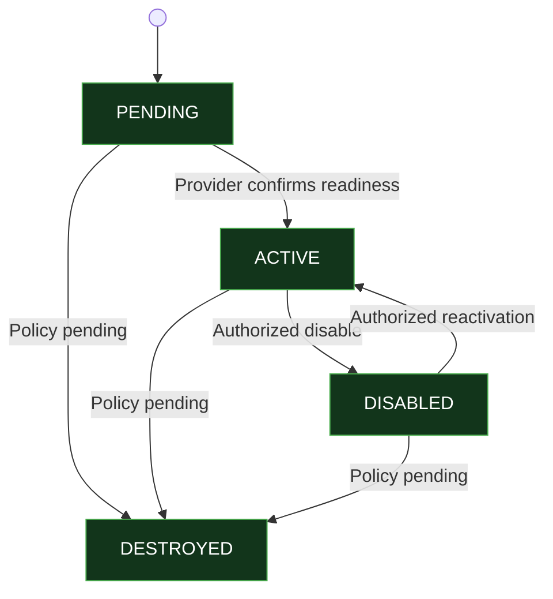

## Phase 11.5.6 — Enforce Persistence and Lifecycle Invariants

`In progress — source review`
No code changes

We’ll follow the agreed workflow: inspect the existing persistence boundaries, identify evidenced gaps, agree on the smallest required changes, and only then implement.

The key objective is to ensure that no persistence path can bypass the lifecycle rules finalized in Steps 11.5.3–11.5.5.

### 1. Initial source evidence

I found previously shared TraceMind source excerpts covering the key repository contracts, transaction adapter, persistence service, and persistence requirements.

The following observations are supported by those excerpts:

| Area                        | Existing evidence                                                     | Initial assessment                                                    |
| --------------------------- | --------------------------------------------------------------------- | --------------------------------------------------------------------- |
| Parent key repository       | Generic `update` supports provider, status, and audit fields          | Lifecycle transitions may bypass dedicated operations                 |
| Version repository          | Generic update accepts lifecycle changes                              | Potential lifecycle bypass                                            |
| Initial creation            | Parent and initial version are inserted in one transaction            | Good foundation                                                       |
| Initial creation validation | Checks key ID, current version, and scope                             | Initial version number `1` and status compatibility need verification |
| Rotation                    | Checks key IDs, expected version, next version sequence, and statuses | Good foundation                                                       |
| Rotation concurrency        | Uses parent locking and expected-current-version validation           | Good foundation                                                       |
| Version uniqueness          | Proposed in schema design                                             | Actual database constraint not verified                               |
| Current-version integrity   | Validated in application transaction logic                            | Database enforcement not verified                                     |
| Provider cleanup            | No recovery implementation established by the reviewed excerpts       | Gap to investigate                                                    |

These are preliminary findings, not confirmation of the current repository state. The source excerpts were previously shared, so we need fresh confirmation before proposing code changes.

### 2. Evidence-based gaps to investigate

The earlier excerpts reveal three important areas.
**Gap A — Parent key lifecycle bypass**
The `current UpdateSecurityKeyPersistenceInput` includes:

```js
type UpdateSecurityKeyPersistenceInput = Partial<
Pick<
SecurityKeyPersistenceRecord,
"provider" | "status" | "updatedAt" | "updatedBy"

> ;
```

Because `status` is accepted by the generic repository update, a caller may potentially change a parent key's lifecycle status without using the approved lifecycle operation.

**Proposed direction**: Restrict generic updates to non-lifecycle metadata and introduce dedicated transactional lifecycle operations.

**Gap B — Version lifecycle bypass**

The earlier persistence requirements explicitly warn against arbitrary, unvalidated lifecycle updates. However, the reviewed version repository contract exposes generic update behavior.

**Proposed direction:** Prevent direct status/timestamp changes through generic repository updates. Lifecycle changes should go through validated operations.

**Gap C — Missing lifecycle transaction operations**

The previously reviewed transaction port demonstrated creation and rotation, but did not establish dedicated transactional operations for:

- Activating a pending key.
- Disabling a parent key.
- Reactivating a parent key.
- Independently disabling an eligible version

**Proposed direction** : Add only the operations required by the finalized lifecycle contract, if the fresh source review confirms they are absent.

### 3. Source files needed for the complete review

Please run these commands from the TraceMind project root and share their output.

**A. Repository contracts and transaction contract**

```js
cat src/modules/security-product/application/interfaces/security-key.repository.port.ts

cat src/modules/security-product/application/interfaces/security-key-version.repository.port.ts

cat src/modules/security-product/application/interfaces/security-key-transaction.port.ts
```

**B. MySQL persistence implementations**

```js
cat src/modules/security-product/infrastructure/persistence/mysql/security-key.mysql.repository.ts

cat src/modules/security-product/infrastructure/persistence/mysql/security-key-version.mysql.repository.ts

cat src/modules/security-product/infrastructure/persistence/mysql/security-key.transaction.mysql.adapter.ts
```

**C. Service and models**

```js
cat src/modules/security-product/application/services/security-key-persistence.service.ts

cat src/modules/security-product/domain/models/security-key-persistence.model.ts

cat src/modules/security-product/domain/models/security-key-version-persistence.model.ts
```

**D. Database schema and migrations**

```js
find src -type f | grep -Ei "security.key|security_key|migration"
```

Share the relevant SQL files or migration contents if they exist.

### 4. What I will verify

| Check                       | Required invariant                                      |
| --------------------------- | ------------------------------------------------------- |
| Parent lifecycle            | Only approved transitions are allowed                   |
| Version lifecycle           | Only approved transitions are allowed                   |
| Initial creation            | Initial version is exactly `1`; statuses are compatible |
| Version sequence            | Next version is exactly current version + 1             |
| Version uniqueness          | Duplicate `(keyId, version)` is rejected                |
| Current-version consistency | Parent references its own valid current version         |
| Active-version uniqueness   | No more than one active version per key                 |
| Tenant isolation            | Every read and mutation uses complete scope             |
| Soft deletion               | Version history remains preserved                       |
| Transactions                | Multi-record transitions are atomic                     |
| Provider recovery           | Cleanup failures can be recorded for recovery           |
| Raw key material            | Never persisted                                         |

### 5. Proposed completion sequence

1. Complete source inspection.
2. Record confirmed gaps against each invariant.
3. Agree on minimal interface and adapter changes.
4. Implement only the approved changes.
5. Add focused lifecycle and persistence regression tests.
6. Run type-check, build, relevant tests, and git diff --check.

   `No implementation changes made`

---

## Phase 11.5.6 — Persistence and Lifecycle Invariants

`Source review received` `No code changes`

I reviewed the repository contracts, both MySQL repositories, the persistence service, models, and transaction adapter you shared.

There are several confirmed lifecycle enforcement gaps. The important distinction is that tenant scoping is already implemented in the repository queries, and rotation already has transactional protection; we should preserve those working parts rather than rewrite them.

### 1. Confirmed findings

| Area                   | Finding                                                                                | Status              |
| ---------------------- | -------------------------------------------------------------------------------------- | ------------------- |
| Parent generic update  | Allows direct `status` changes                                                         | Gap                 |
| Version generic update | Allows direct status and lifecycle timestamp changes                                   | Gap                 |
| Version creation       | Can insert a version independently of the parent current version                       | Gap                 |
| Initial creation       | Does not enforce version `1` or compatible initial statuses                            | Gap                 |
| Rotation               | Uses transaction, parent row lock, expected version and status checks                  | Existing protection |
| Rotation input         | Does not visibly validate all supplied next-version metadata against the persisted key | Needs enforcement   |
| Soft deletion          | Directly soft-deletes parent key without a lifecycle transaction                       | Policy boundary     |
| Tenant scope           | Full scope predicates are applied to parent and version queries                        | Existing protection |
| Schema constraints     | No SQL migration or actual DDL was found in the supplied file list                     | Unverified          |

**Important details**

**1. Generic parent update**

The repository accepts `status`, so it can bypass the parent lifecycle state machine.

**2. Generic version update**

The version repository can directly change `status`, `activatedAt`, `rotatedAt`, `disabledAt`, and `destroyedAt`. This is the clearest bypass of version lifecycle policy.

**3. Independent version creation**

`SecurityKeyVersionMySQLRepository.create()` checks that the parent exists within the supplied scope, but does not check that:

- The parent is active.
- The version is the expected next version.
- The version status is valid for its creation context.
- The parent `currentVersion` is updated atomically.

This can produce inconsistent key history.

**4. Rotation validation**

The transaction adapter already handles locking, stale-version detection, the previous-version transition, insertion of the next version, and parent current-version update atomically.

However, the supplied next-version record should also be checked against the persisted key's purpose and provider workflow. The adapter currently validates its key ID, sequence, and status, but not every metadata field.

### 2. Proposed minimal changes

I recommend the following changes for Step 11.5.6:

### 2. Proposed minimal changes

I recommend the following changes for Step 11.5.6:

| File / component                            | Proposed change                                                                       |
| ------------------------------------------- | ------------------------------------------------------------------------------------- |
| `security-key.repository.port.ts`           | Remove `status` from generic update input                                             |
| `security-key.mysql.repository.ts`          | Remove direct status mutation from generic update                                     |
| `security-key-version.repository.port.ts`   | Remove generic lifecycle update operation                                             |
| `security-key-version.mysql.repository.ts`  | Prevent independent version lifecycle updates; retain scoped reads                    |
| `security-key-transaction.port.ts`          | Add only the approved lifecycle transaction operations                                |
| `security-key.transaction.mysql.adapter.ts` | Enforce initial creation and rotation invariants, plus approved lifecycle transitions |
| `security-key-persistence.service.ts`       | Expose the approved lifecycle operations through the application service              |

I would also make version creation available only through the transaction-aware lifecycle flow, rather than allowing callers to create arbitrary standalone versions.

### 3. Invariants to enforce

1. Initial version must be 1.
2. Initial key and version statuses must be compatible with the provider workflow.
3. Only an active parent key can be rotated.
4. Rotation must use the persisted current version.
5. The next version must be exactly current version + 1.
6. Previous and next versions must belong to the same key and match its purpose.
7. Parent currentVersion must update in the same transaction as version history.
8. Parent disable must preserve individual version statuses.
9. No generic repository update may bypass lifecycle transitions.
10. Historical versions must remain preserved.
11. No raw key material may enter persistence.
    The exact rules for reactivation, independent version disabling, historical decryption, and destruction remain subject to the lifecycle decisions from Step 11.5.3. I won't silently decide those policies.

### 4. One approval before implementation

Before changing interfaces, I need to close the three pending lifecycle decisions:

`A. Parent key reactivation`: Should a disabled parent key be reactivated through a controlled operation, or remain disabled permanently?

`B. Individual version disabling`: Should versions support independent disabling, or should disabling happen only at parent-key level?

`C. Historical decryption`: Should DECRYPT_ONLY versions remain usable for historical decryption while their parent key is active?

You can reply in this format:

```js
A. Controlled reactivation / Permanently disabled / Review
B. Independent version disable / Parent-only disable / Review
C. Allow historical decryption / ACTIVE only / Review
```

After these decisions, I'll finalize the exact persistence invariants and proposed interface changes for your approval. No source code has been modified.

Before moving into implementation, we need to finalize Step 11.5.3 — Lifecycle State Machine. Three policy decisions are still pending, and they directly affect the lifecycle rules and persistence changes.

Please confirm these three decisions

**A. Parent key reactivation**

- Controlled reactivation — a disabled key can be reactivated through an authorized operation.
- Permanently disabled — once disabled, it cannot be reactivated.
- Review — defer the decision.

**B. Independent version disabling**

- Independent version disable — individual versions can be disabled separately.
- Parent-only disable — versions cannot be independently disabled.
- Review — defer the decision.

**C. Historical decryption**

- Allow historical decryption — DECRYPT_ONLY versions can be used for historical decryption while the parent key is ACTIVE.
- `ACTIVE` only — only `ACTIVE` versions can be used.
- Review — defer the decision.
  My recommended defaults are A: Controlled reactivation, B: Independent version disable, C: Allow historical decryption. These are recommendations, not approved decisions.

Reply with your choices:

```js
A. Controlled reactivation
B. Parent-only disable
C. Allow historical decryption
```

### Parent Key State Machine


