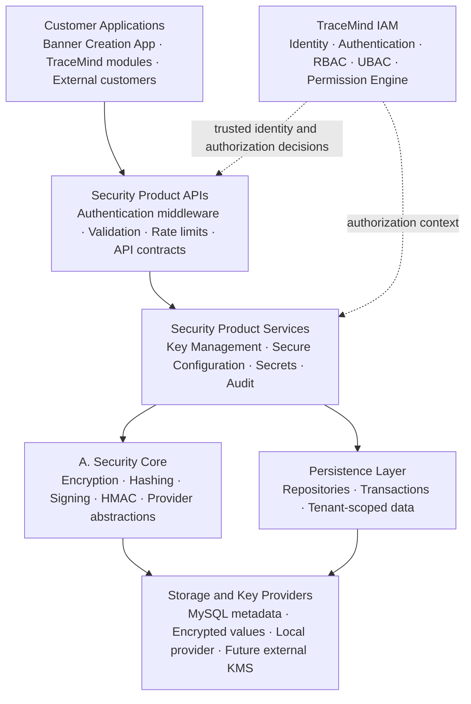
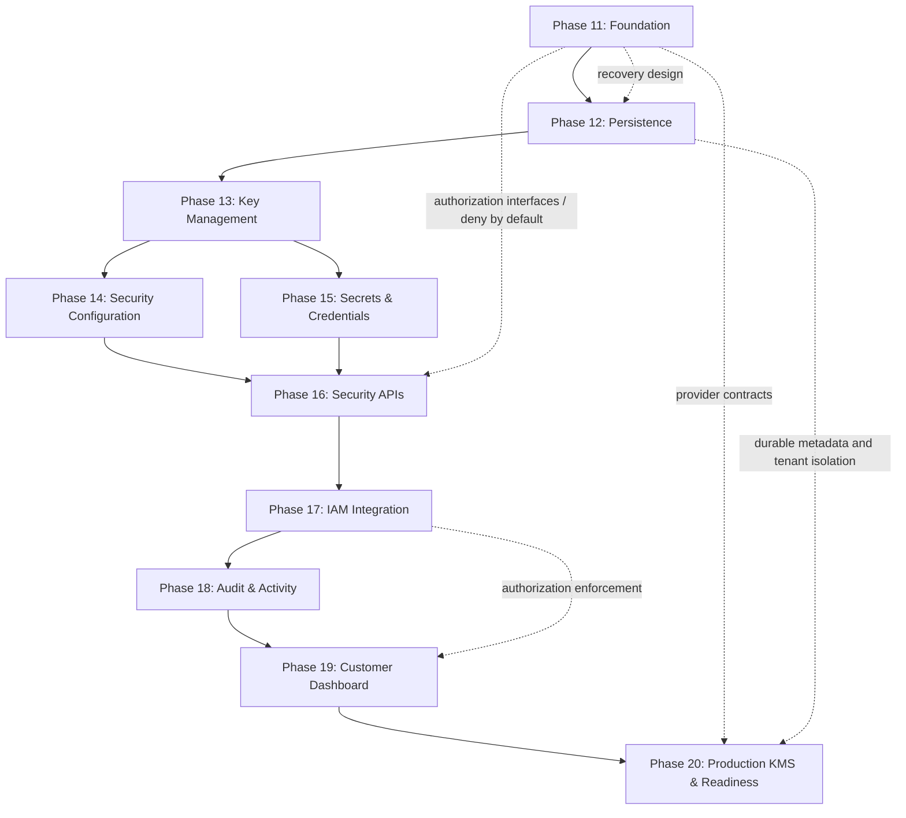

## TraceMind — Security Product Roadmap (B: Database + APIs)

We've completed **A. Security Core — Reusable Engine** according to your reported verification results. Now we need to build **B. Security Product — Database + APIs** as a customer-facing, persistent, multi-tenant security service.
The key architectural decision is that Security Core provides cryptographic capabilities, while Security Product manages the complete lifecycle of keys, configurations, secrets, permissions, persistence, and customer-facing APIs. This follows our existing TraceMind direction: Core → Provider → Persistence → Service → API → IAM → Customer.

# TraceMind Security Product

**Architecture, implementation roadmap, security controls, and production-readiness plan**

> Scope: Phases 11–20 of the Security Product roadmap, with Phase 21 reserved for ongoing operational maturity. The plan assumes a Node.js + TypeScript codebase and preserves the existing reusable Security Core and standalone TraceMind IAM boundaries.

---

## 1. Architecture: how A and B fit together

### Customer Applications

Banner Creation App, TraceMind modules, external customers

### Security Product APIs

Authentication middleware · Validation · Rate limits · API contracts

### Security Product Services

Key Management · Secure Configuration · Secrets · Audit

A. Security Core

Encryption · Hashing · Signing · HMAC · Provider abstractions

Persistence Layer

Repositories · Transactions · Tenant-scoped data

### Storage and Key Providers

MySQL metadata · Encrypted values · Local provider · Future external KMS

### TraceMind IAM

Identity · Authentication · RBAC · UBAC · Permission Engine

Separate service, integrated with the Security Product

### Architecture diagram



This is a logical architecture, not a requirement to deploy every component as a separate microservice immediately. We can maintain modular boundaries in the existing Node.js + TypeScript application and extract independent services later when needed.

### Non-negotiable design decisions

- Security Core remains reusable. Do not duplicate encryption, hashing, signing, HMAC, or cryptographic provider internals in product modules.
- Persistence must be durable. In-memory key metadata is not sufficient for a multi-tenant production service.
- Keys and encrypted values are different. Store key metadata and versions in MySQL; keep raw key material behind the appropriate provider boundary.
- IAM owns authorization. Security Product consumes trusted identity and permission decisions rather than creating a competing RBAC implementation.
- Tenant isolation is mandatory. Every resource access must be scoped to the authenticated organization and relevant project, application, or environment.
- Production KMS support starts in the architecture, not only in Phase 20. Provider interfaces and data models must support external KMS from the beginning, even though production integration comes later.

## 2. The 10-phase implementation roadmap

Phases 11–20 · Ordered implementation plan with explicit deliverables and completion gates.

| Phase | Workstream                                 | Primary outcome                                                                 |
| ----- | ------------------------------------------ | ------------------------------------------------------------------------------- |
| 11    | Security Product Foundation                | Stable module boundaries, contracts, trust assumptions, and provider interfaces |
| 12    | Security Database & Persistence            | Durable, tenant-scoped metadata and repositories                                |
| 13    | Key Management Service                     | Persistent key metadata, versions, lifecycle, and rotation                      |
| 14    | Security Configuration                     | Scope-aware, versioned security configuration                                   |
| 15    | Secrets & Credentials                      | Encrypted secret storage, controlled retrieval, rotation, and auditability      |
| 16    | Security APIs                              | Versioned, validated APIs with secure defaults                                  |
| 17    | Authentication & Authorization Integration | Centralized IAM, RBAC/UBAC, and tenant-boundary enforcement                     |
| 18    | Security Audit & Activity                  | Searchable, access-controlled security event history                            |
| 19    | Customer Security Dashboard                | Authorized customer console using Security APIs                                 |
| 20    | Production Security / KMS Integration      | Production provider integration, recovery, testing, and release sign-off        |

---

### 11. Security Product Foundation

Architecture & contracts

Objective: establish the product's boundaries and technical foundation before introducing persistent security resources.

Implementation steps:

- 11.1 Inspect the existing Security Core, provider contracts, container, and project conventions.
- 11.2 Define product modules, dependency rules, and service boundaries.
- 11.3 Define the tenant/resource hierarchy: organization → project → application → environment.
- 11.4 Define shared types, DTOs, status enums, domain errors, and API response conventions.
- 11.5 Define configuration, secrets, keys, audit, and provider contracts.
- 11.6 Establish request context, correlation IDs, validation, and secure defaults.
- 11.7 Document threat boundaries, trust assumptions, and external KMS compatibility.

Deliverable: a modular Security Product foundation with stable contracts and no unnecessary duplication of Security Core.

### 12. Security Database & Persistence

Durability & tenant isolation

Objective: persist security resources safely and consistently.

Implementation steps:

- 12.1 Design MySQL schemas, relationships, indexes, foreign keys, and uniqueness rules.
- 12.2 Create versioned database migrations and rollback procedures.
- 12.3 Persist organizations, projects, applications, and environments or integrate with the authoritative tenant source.
- 12.4 Create repositories for key metadata, configuration metadata, secret metadata, and audit events.
- 12.5 Implement tenant-scoped repository contracts and ownership validation.
- 12.6 Define transactions, concurrency control, idempotency, and soft-delete/retention rules.
- 12.7 Test restart persistence, isolation boundaries, constraint failures, and migration behavior.

Deliverable: durable repositories with tenant isolation enforced at service and data-access boundaries.

Important: MySQL must not become a place to store raw encryption keys or plaintext secrets.

### 13. Key Management Service

Lifecycle & versioning

Objective: build a persistent service around the existing key-provider and crypto abstractions.

Implementation steps:

- 13.1 Define key records, provider references, purposes, scopes, versions, and lifecycle states.
- 13.2 Implement key creation and metadata persistence.
- 13.3 Implement active-version lookup and key-version history.
- 13.4 Implement rotation workflows, version transitions, and retained-version decryption.
- 13.5 Define disable, revoke, archive, and delete behavior according to explicit lifecycle contracts.
- 13.6 Add key ownership checks, concurrency protection, and recovery behavior.
- 13.7 Test restart behavior, missing keys, rotation failures, and backward compatibility.

Deliverable: persistent, version-aware key management without exposing raw key material through the service API.

### 14 Security Configuration

Policy & configuration lifecycle

Objective: securely manage settings and security policies at different scopes.

Implementation steps:

- 14.1 Define configuration schemas and supported value types.
- 14.2 Implement organization/project/application/environment scope resolution.
- 14.3 Define inheritance, precedence, and override restrictions.
- 14.4 Encrypt sensitive configuration fields through Security Core.
- 14.5 Add version history, validation, change tracking, and controlled rollback.
- 14.6 Define cache invalidation and configuration update semantics.
- 14.7 Test cross-tenant access, invalid configurations, and secret leakage.

Deliverable: persistent, versioned, scope-aware secure configuration.

### 15. Secrets & Credentials

Secret storage & access

Objective: manage recoverable secrets without exposing their values unnecessarily.

Implementation steps:

- 15.1 Define secret types, ownership, scope, metadata, and lifecycle states.
- 15.2 Implement secret creation and encryption using Security Core.
- 15.3 Implement authorized retrieval and safe, masked metadata responses.
- 15.4 Add secret versioning, rotation, expiry, and revocation.
- 15.5 Support relevant credentials such as API credentials, webhook secrets, and integration credentials.
- 15.6 Add access policies, usage tracking, and audit events.
- 15.7 Test retrieval authorization, secret rotation, expiry, and redaction.

Deliverable: a controlled secrets service with encrypted persistence and traceable access.

Design rule: recoverable credentials are encrypted; passwords and other one-way-verification values use appropriate password hashing instead.

### 16. Security APIs

Public service contracts

Objective: expose the product capabilities through stable, validated APIs.

Implementation steps:

- 16.1 Define REST endpoints, API versioning, DTOs, and OpenAPI contracts.
- 16.2 Implement key-management endpoints.
- 16.3 Implement secure-configuration endpoints.
- 16.4 Implement secret and credential endpoints.
- 16.5 Add request validation, pagination, consistent errors, and idempotency where appropriate.
- 16.6 Add authentication middleware integration points, rate limits, request-size limits, and safe response handling.
- 16.7 Add contract, integration, and negative-path tests.

Deliverable: documented APIs with consistent contracts and secure defaults.

Important: the complete authorization integration follows in Phase 17. Until then, sensitive endpoints must not be exposed as usable unauthenticated production APIs.

### 17. Authentication & Authorization Integration

IAM integration

Objective: enforce identity, permissions, and tenant boundaries consistently.

Implementation steps:

- 17.1 Integrate with the authoritative TraceMind IAM service.
- 17.2 Define trusted actor and service identity context.
- 17.3 Map organization, project, application, and environment scopes.
- 17.4 Enforce RBAC and UBAC decisions through the IAM Permission Engine.
- 17.5 Apply least privilege to key, configuration, and secret operations.
- 17.6 Enforce authorization at API and service boundaries, with tenant-scoped repository safeguards.
- 17.7 Test unauthorized, cross-tenant, privilege-escalation, and revoked-access scenarios.

Deliverable: Security Product capabilities protected by centralized identity and authorization.

IAM remains independently productizable; Security Product should not implement a parallel permission engine.

### 18. Security Audit & Activity

Accountability & evidence

Objective: maintain trustworthy records of security-sensitive operations.

Implementation steps:

- 18.1 Define audit event types, actor identity, tenant context, resource, action, outcome, and timestamp.
- 18.2 Record key creation, rotation, disablement, and lifecycle changes.
- 18.3 Record configuration changes and secret access/rotation events.
- 18.4 Connect audit records with request and correlation IDs.
- 18.5 Implement append-only application behavior, access restrictions, and retention rules.
- 18.6 Add filtering, pagination, and authorized audit retrieval.
- 18.7 Test completeness, tenant isolation, integrity controls, and redaction.

Deliverable: searchable, access-controlled security audit history.

Audit events must never include raw keys, plaintext secrets, passwords, or authentication tokens.

### 19. Customer Security Dashboard

Customer operations

Objective: let customers manage security resources through an authorized interface.

Implementation steps:

- 19.1 Define dashboard navigation and organization/project context.
- 19.2 Build key inventory, status, version, and rotation views.
- 19.3 Build secure-configuration management views.
- 19.4 Build secrets inventory and lifecycle views with masked values.
- 19.5 Build audit/activity search and filters.
- 19.6 Add role-aware controls, loading/error states, and confirmation flows for destructive actions.
- 19.7 Test tenant switching, permissions, data exposure, and API integration.

Deliverable: a customer-facing security console that uses the Security APIs rather than bypassing them through direct database access.

### 20. Production Security / KMS Integration

Production readiness

Objective: move from development/local providers to production-grade key management and deployment controls.

Implementation steps:

- 20.1 Select the supported KMS integration(s) based on deployment requirements.
- 20.2 Implement provider adapters using the existing provider contracts.
- 20.3 Configure key wrapping/unwrapping and envelope-encryption integration.
- 20.4 Set up workload identity, provider credentials, and least-privilege permissions.
- 20.5 Define rotation, recovery, availability, and migration procedures.
- 20.6 Test KMS outages, timeouts, throttling, permission failures, and recovery.
- 20.7 Perform staging validation, operational security review, and production-readiness sign-off.

Deliverable: a production-capable provider integration with tested failure and recovery behavior.

Rule: no silent fallback to local keys when production KMS operations fail.

## 3. What I recommend adding to your plan

Your ten phases cover the main product features. However, a production multi-tenant security product also needs several concerns explicitly tracked. I recommend adding these as mandatory cross-cutting work, rather than expanding the main roadmap immediately.

### A. Threat modelling and security design

`Add to Phase 11`

Define trust boundaries, attack scenarios, data classification, tenant isolation threats, abuse cases, and security acceptance criteria before implementing persistence and APIs.

### B. Backup, restore, and disaster recovery

`Add to Phases 12 and 20`

Document and test database backup, encrypted-data recovery, key-version retention, restore procedures, and recovery when the KMS or provider is unavailable. A database backup without the corresponding key material or key-provider access may be unusable.

### C. Operational monitoring and alerting

`Add to Phases 18 and 20`

Integrate with TraceMind's observability capabilities to monitor failed authorization, repeated secret-access failures, key rotation failures, KMS outages, latency, rate limits, and unusual access patterns. Do not send secret values into telemetry.

### D. Resource limits and abuse prevention

`Add to Phases 11 and 16`

Define limits for API request rates, payload sizes, secret counts, key creation, configuration versions, and audit queries. Enforce product entitlements through the appropriate entitlement service rather than hardcoding plan logic in each module.

### E. Security assurance and release readiness

`Add to Phase 20`

Include dependency and vulnerability checks, secret scanning, authorization tests, migration validation, deployment configuration review, incident-response procedures, and documented release criteria. Add independent security testing before production launch.

### Should we add Phase 21?

My recommendation is to keep Phases 11–20 as the core Security Product build and create a separate follow-up phase:

### Phase 21 — Security Operations, Reliability & Compliance

This would cover ongoing vulnerability management, incident response, disaster-recovery exercises, retention and deletion verification, operational SLOs, compliance evidence, and periodic access reviews.

Phase 20 should still include the minimum production-readiness checks needed before launch. Phase 21 would establish ongoing operational maturity rather than delay essential launch requirements.

## 4. Recommended implementation dependencies

Although the phases are numbered sequentially, some design work needs to happen earlier than its main implementation phase.



This is the recommended delivery sequence. In practice, security audit event contracts should be defined early in Phase 11, and audit persistence should be developed alongside the relevant features—not left entirely until Phase 18.

Similarly, authentication middleware interfaces and deny-by-default behavior must exist before sensitive APIs are exposed, even though full IAM integration is Phase 17.

## 5. Mandatory completion gates for every phase

Use the same disciplined workflow that we followed for Security Core.

### Phase completion checklist

```js
Inspect the current source, interfaces, and package scripts.

Document requirements and acceptance criteria.

Implement the smallest necessary changes.

Add and run targeted automated specs.

Run all security manual tests.

Run the full security regression suite.

Run TypeScript type-check and build.

Review tenant isolation, authorization, and sensitive-data exposure.

Review changed files, documentation, and migration safety.

Obtain confirmation before moving to the next phase.
```

A passing test suite is not a substitute for verifying security behavior. We must not mark a phase complete until its applicable acceptance criteria are met.

## 6. Final recommendations

| Decision       | Recommendation                                                                     |
| -------------- | ---------------------------------------------------------------------------------- |
| Main roadmap   | Keep your 10 phases, numbered 11–20                                                |
| Database       | Prioritize durable, tenant-scoped persistence before building product APIs         |
| Key management | Persist metadata and versions; keep raw key material behind provider abstractions  |
| Secrets        | Encrypt recoverable secrets; redact values from logs and dashboard responses       |
| IAM            | Use the standalone TraceMind IAM service and its Permission Engine                 |
| Audit          | Design event contracts early and build audit persistence alongside features        |
| External KMS   | Design for it in Phase 11; integrate and validate production providers in Phase 20 |
| Phase 21       | Add Security Operations, Reliability & Compliance as a follow-up maturity phase    |
| Delivery       | One phase at a time, with explicit verification and your confirmation              |

The most important sequencing decision is Phase 12 before Phase 13. Your reusable Security Core is the cryptographic foundation, but the product cannot become a durable, multi-tenant security service until key metadata, versions, ownership, and lifecycle operations survive application restarts and are safely scoped to each tenant.

Our next step should be Phase 11.1 — inspect the current TraceMind source, package scripts, Security Core contracts, and existing database conventions. We should use your latest project files as the baseline, then establish the exact Phase 11 implementation plan before changing code.
