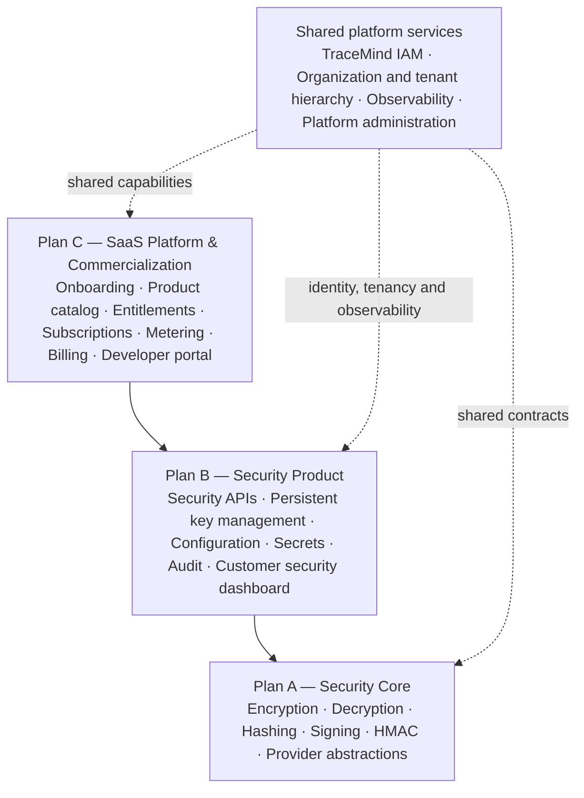
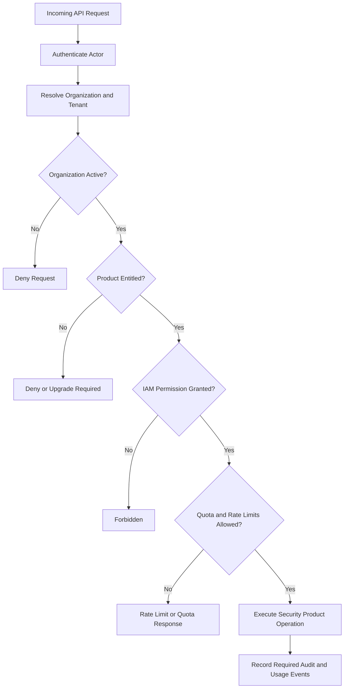

# TraceMind — SaaS Platform & Commercialization Roadmap

> **Scope:** Plan C, Phases 21–30. This document builds on Plan A (Security Core) and Plan B (Security Product).

The important distinction is:

- Plan A — Security Core: the reusable cryptographic engine.
- Plan B — Security Product: the persistent security services, database, APIs, and security-management dashboard.
- Plan C — SaaS Platform: the customer onboarding, product access, subscription, entitlement, usage, billing, developer experience, and platform operations that make Plan B commercially deliverable.

This also fits our existing TraceMind vision: the Banner Creation App can be an early customer, and IAM and Security should be independently productizable rather than tightly coupled into one application.&#x20;

## 1. What I found in your `zip-8` project

I inspected the uploaded archive's project structure, package scripts, tenant schema files, and key-management/encryption implementation.

### Tenant foundation exists

The archive contains MySQL schemas for organizations, projects, applications, and environments, including composite foreign keys to enforce parts of the tenant hierarchy.

### Security Core has provider abstractions

The local key provider in the archive stores key metadata and versions in in-memory `Map` objects. Plan B's persistent key-management layer must replace that as the authoritative production persistence mechanism without breaking the Core contracts.

### IAM is not yet implemented in this snapshot

The `src/modules/iam/` directory has no source files in this archive. Your planned IAM integration therefore needs to account for the actual implementation and contracts when they become available.

### No commercial SaaS layer is evident in this snapshot

The inspected `package.json` includes application, database-schema, build, and Security Core test scripts, but no subscription, licensing, billing, or usage-metering scripts. This is not proof that no related code exists anywhere, but the archive does not establish those capabilities.

The conclusion is that we should not treat a working Security API as equivalent to a commercially ready SaaS platform.

## 2. Recommended overall TraceMind product architecture

## Plan C — SaaS Platform & Commercialization

Onboarding · Product catalog · Entitlements · Subscriptions · Metering · Billing · Developer portal

## Plan B — Security Product

Security APIs · Persistent key management · Configuration · Secrets · Audit · Customer security dashboard

## Plan A — Security Core

Encryption · Decryption · Hashing · Signing · HMAC · Provider abstractions

### Shared platform services

TraceMind IAM · Organization and tenant hierarchy · Observability · Platform administration

This is a logical architecture. It does not require three separately deployed applications. We can begin with modular services in the existing Node.js + TypeScript codebase and separate deployments later if scale or isolation requirements justify it.

### The critical boundary

Plan C must not reimplement the security operations already provided by Plan A or Plan B.

For example:

- Plan A encrypts and decrypts data.
- Plan B manages security resources and exposes the relevant APIs.
- Plan C decides whether an organization has access to the Security Product, which plan it subscribes to, how much it can use, and how that usage is billed.

Similarly, IAM decides whether a particular actor is authorized to perform an operation. Product entitlement decides whether that organization has purchased or otherwise been granted the relevant capability. Both checks are required; neither replaces the other.

## 3. Plan C — SaaS Platform & Commercialization

I recommend ten phases, continuing the numbering after Plan B.

Phases 21–30 · Recommended implementation sequence

## Plan C phase overview

| Phase | Focus                                          | Primary outcome                                 |
| ----- | ---------------------------------------------- | ----------------------------------------------- |
| 21    | SaaS Control Plane Foundation                  | Stable commercial-platform contracts            |
| 22    | Customer Onboarding & Tenant Lifecycle         | Automated, tenant-safe provisioning             |
| 23    | Product Catalog & Subscription Management      | Durable product and subscription model          |
| 24    | Entitlements & Licensing Engine                | Central feature-access and licensing decisions  |
| 25    | Usage Metering, Quotas & Limits                | Reliable usage accounting and resource controls |
| 26    | Developer Access & Integration Platform        | Secure customer integration experience          |
| 27    | Billing, Invoicing & Payments                  | Traceable commercial transaction lifecycle      |
| 28    | Customer Account & SaaS Console                | Customer-facing account and billing console     |
| 29    | Platform Administration, Reliability & Support | Operable, observable, recoverable platform      |
| 30    | SaaS Launch & Commercial Readiness             | Evidence-backed production launch decision      |

### 21. SaaS Control Plane Foundation

Purpose: establish the shared commercial platform that controls access to TraceMind products.

Implementation:

- Define the product catalog: IAM, Security, and IAM + Security.
- Define the separation between customer organization, subscription, product, and tenant resources.
- Design the subscription and entitlement contracts.
- Define platform-level states, errors, events, and service interfaces.
- Establish platform-admin versus customer-admin boundaries.
- Define how managed SaaS, customer-managed deployments, and future hybrid options will differ.
- Define tenant lifecycle, service dependencies, and security assumptions.

Deliverable: a documented SaaS control-plane architecture and stable contracts.

This phase is particularly important because entitlement checks need to be designed into the product APIs, even before the commercial entitlement engine is fully implemented.

### 22. Customer Onboarding & Tenant Lifecycle

Purpose: let customers start using TraceMind without manual database setup.

Implementation:

- Customer registration or invitation-based onboarding.
- Organization creation and initial administrator assignment.
- Organization → project → application → environment provisioning.
- Tenant activation, suspension, reactivation, and closure workflows.
- Idempotent provisioning and rollback after partial failure.
- Customer identity integration through TraceMind IAM or supported external identity providers.
- Onboarding status and lifecycle audit events.

Deliverable: repeatable, automated customer provisioning with tenant isolation.

This should orchestrate the existing tenant services rather than create a competing tenant hierarchy.

### 23. Product Catalog & Subscription Management

Purpose: represent which products and commercial plans customers subscribe to.

Implementation:

- Product catalog and plan definitions.
- Free, trial, paid, enterprise, and custom-contract plan types where required.
- Subscription lifecycle: trial, active, past due, suspended, canceled, and expired.
- Subscription assignment to the correct customer organization.
- Plan changes, upgrades, downgrades, and renewal dates.
- Subscription history and administrative overrides.
- Rules for subscription changes and effective dates.

Deliverable: a durable subscription model independent of Security Core and the IAM permission engine.

### 24. Entitlements & Licensing Engine

Purpose: enforce which TraceMind products and features an organization is entitled to use.

Implementation:

- Organization-level product entitlements.
- Feature and module entitlements.
- Plan limits, add-ons, trials, and enterprise overrides.
- Effective entitlement resolution and caching.
- Entitlement checks at API/service boundaries.
- Entitlement changes, expiry, revocation, and audit history.
- Defined behavior during subscription-service outages.

Deliverable: a central entitlement engine that supports modular pricing and licensing.

Critical rule: evaluate product entitlement before actor-level permission. A user cannot gain a paid capability merely because their IAM role grants a broad permission.

### 25. Usage Metering, Quotas & Limits

Purpose: measure consumption and prevent uncontrolled resource use.

Implementation:

- Define billable and operational metrics for Security and IAM.
- Meter API calls, stored resources, key operations, secret storage, and other approved usage dimensions.
- Apply rate limits and configurable quotas.
- Record usage with tenant, product, time window, and idempotency identifiers.
- Handle retries, duplicate events, delayed reporting, and aggregation.
- Define hard limits versus soft warnings and overage policies.
- Provide usage summaries and threshold alerts.

Deliverable: reliable usage accounting and resource controls.

Do not count every internal cryptographic operation as a separately billable unit without a clear product and pricing decision.

### 26. Developer Access & Integration Platform

Purpose: make it practical for customer applications to integrate with TraceMind.

Implementation:

- Customer service identities and API credential lifecycle.
- Scoped credentials with expiry, rotation, revocation, and last-used metadata.
- Credential issuance and one-time display of newly generated secrets.
- API documentation, OpenAPI specifications, and integration examples.
- SDK strategy and initial client integration.
- Webhooks or events for relevant subscription, usage, and security lifecycle changes.
- Developer sandbox and integration testing.

Deliverable: a controlled developer experience for external applications.

Customer API credentials must be stored using appropriate one-way verification or protected credential handling, not as plaintext values in the database. Their authorization must still be enforced by IAM and the relevant product entitlements.

### 27. Billing, Invoicing & Payments

Purpose: connect subscriptions and measured usage to the commercial transaction lifecycle.

Implementation:

- Pricing rules and billing-period calculations.
- Recurring subscriptions and approved usage-based charges.
- Invoice generation, credit notes, taxes, and payment status.
- Payment-provider integration.
- Payment retries, webhook verification, reconciliation, and duplicate-event protection.
- Dunning and past-due policies.
- Billing history and finance audit trail.

Deliverable: a traceable billing lifecycle.

Keep billing-provider integration behind an interface so a provider can be changed without rewriting product entitlements.

### 28. Customer Account & SaaS Console

Purpose: give customers visibility into their TraceMind account and commercial relationship.

Implementation:

- Organization profile and member-management entry points.
- Active products, plan details, subscription status, and renewal information.
- Usage dashboards and quota consumption.
- Billing history and invoice access.
- API credential management and integration status.
- Upgrade, downgrade, and cancellation flows.
- Role-aware navigation and organization switching.

Deliverable: a SaaS account console.

This is different from Plan B's Customer Security Dashboard, which manages keys, secrets, configurations, and security audit records. Both can eventually live in one TraceMind portal but should remain separate functional modules.

### 29. Platform Administration, Reliability & Support

Purpose: operate the SaaS platform safely across all customers.

Implementation:

- Restricted platform-operator console.
- Customer provisioning and lifecycle support workflows.
- Operational health, error rates, latency, and capacity monitoring.
- Tenant-specific usage and operational diagnostics.
- Incident management, support records, and administrative audit events.
- Backup, restore, disaster recovery, and retention procedures.
- Security monitoring, dependency scanning, and incident-response playbooks.
- SLOs and escalation procedures.

Deliverable: a supportable, observable, recoverable platform with strict separation between platform operators and customer administrators.

### 30.SaaS Launch & Commercial Readiness

Purpose: verify that the complete product can be offered to external customers reliably.

Implementation:

- End-to-end onboarding → subscription → entitlement → authorization → usage → billing tests.
- Tenant-isolation and privilege-escalation testing.
- Performance, rate-limit, load, and failure-recovery tests.
- Production KMS and credential-management verification.
- Migration, backup, restore, and rollback drills.
- Legal and privacy documentation review, appropriate contractual terms, and data-retention policy.
- Customer support, incident response, and release procedures.
- Pilot onboarding, operational acceptance criteria, and launch sign-off.

Deliverable: a documented go-live decision supported by test evidence and operational readiness—not merely a successful build.

## 4. How Plan B and Plan C must work together

There is one important sequencing adjustment I recommend.

Although Plan C is the commercial layer after Plan B, we should design its contracts during Plan B rather than wait until Phase 20 is complete.

| Plan B phase                            | What Plan C needs from it                                                                    |
| --------------------------------------- | -------------------------------------------------------------------------------------------- |
| Phase 11 — Foundation                   | Product identifiers, tenant boundaries, entitlement interfaces, and security contracts       |
| Phase 12 — Persistence                  | Durable organization and resource ownership; a foundation for subscription and usage records |
| Phase 13 — Key Management               | Persistent key metadata, version lifecycle, and provider references                          |
| Phase 14–15 — Configuration and Secrets | Resource ownership, lifecycle events, and usage dimensions                                   |
| Phase 16 — Security APIs                | Consistent API contracts and hooks for authentication, entitlement, quotas, and audit        |
| Phase 17 — IAM Integration              | Trusted identities and centralized authorization                                             |
| Phase 18 — Audit & Activity             | Security and commercial audit-event foundations                                              |
| Phase 19 — Customer Security Dashboard  | Reusable customer portal patterns, without mixing in billing UI                              |
| Phase 20 — Production KMS               | Production-grade key-provider integration and operational readiness                          |

The key is to avoid building Plan B APIs that later need a large redesign to support commercial plans, usage limits, or customer subscriptions.

### Required request-authorization flow

For a customer request to use a Security API, the logical flow should be:

The implementation must define how failures in entitlement or usage services behave. For example, an entitlement-service outage must not silently grant paid features. Authorization must also be checked at the appropriate service boundaries, not only in the UI or API middleware.

## 5. Three important product decisions

Before implementing Plan C, I recommend keeping these decisions explicit.

### Decision 1 — Modular products

TraceMind should support Security-only, IAM-only, and IAM + Security offerings. Each organization receives the product entitlements associated with its subscription or an approved enterprise grant. A customer's identity provider choice should not force them to purchase an unrelated product.

### Decision 2 — Pricing and usage units

Do not finalize billing calculations until we define the commercial units. API requests, cryptographic operations, stored secrets, key counts, and retention can have very different cost implications. Start with measurable usage and configurable quotas; finalize pricing through the product catalog.

### Decision 3 — Deployment model

Start with a managed multi-tenant SaaS architecture unless a customer requirement dictates otherwise. Keep provider and storage interfaces compatible with future customer-managed or hybrid deployments, but don't build all deployment models simultaneously.

## 6. Final recommendation

Your overall roadmap should now be:

### A Security Core — Reusable Engine

`Reported complete · Phases 1–10`

Cryptographic capabilities and provider abstractions.

### B Security Product — Database + APIs

`Planned · Phases 11–20`

Persistent security services, IAM integration, customer security dashboard, and production KMS.

### C SaaS Platform & Commercialization

`Recommended · Phases 21–30`

Customer onboarding, subscriptions, licensing, entitlements, usage metering, developer access, billing, platform operations, and launch readiness.

**My strongest recommendation:** approve Plan C as a separate roadmap, preserve the ten phases of Plan B, and introduce entitlement and metering integration points during B's foundation and API design. Implement the full commercial control plane through Plan C.

This gives TraceMind a clearer path from a reusable security engine to a persistent Security Product and finally to a commercially operable SaaS offering—without duplicating Core functionality or creating a second IAM system.

The next development task remains Plan B, Phase 11.1 — inspect the latest source and establish the Security Product foundation. Plan C is the architectural and commercial roadmap we will build toward, not a reason to skip or reorder the current phase workflow.

## 7. Architecture and request-flow notes

The diagrams in this document are logical views of the boundaries and checks described in the roadmap. They do not imply that each plan must initially run as a separately deployed service.

For Security API requests, the intended control sequence is authentication, tenant resolution, organization status, product entitlement, IAM authorization, quota/rate-limit enforcement, operation execution, and required audit/usage recording. Fail-closed behavior is required where a missing decision could otherwise grant paid or sensitive capabilities.
