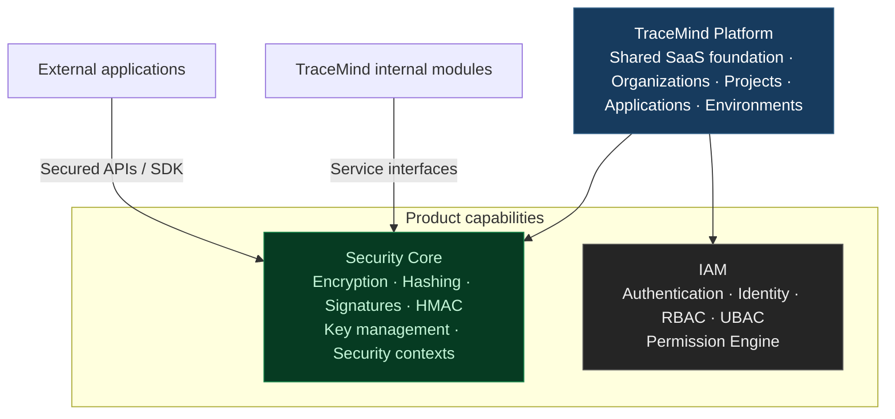
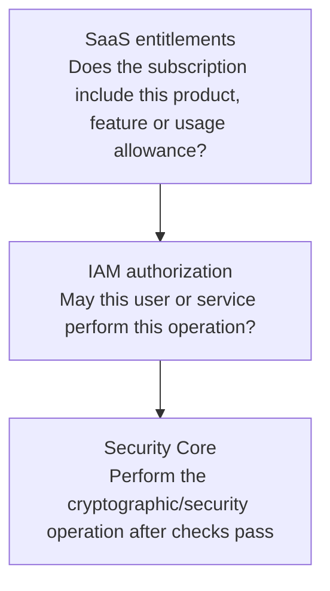
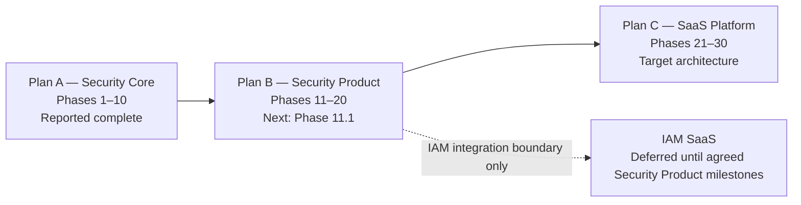

# TraceMind — Security Core SaaS Development Roadmap

> **Purpose:** Complete the reusable Security Core, deliver it as a production-ready Security Product, and prepare for SaaS commercialization without prematurely expanding into the full IAM product.

Your business model is clear now: TraceMind is the main SaaS platform, and Security Core is one of its independently consumable SaaS products. TraceMind itself uses Security Core internally, while external companies can integrate Security Core into their own applications. IAM will follow later as another reusable SaaS product.

The roadmap should therefore focus on finishing Security Core, making it a production-ready Security Product, and then making that product available to external customers—without prematurely building IAM or the complete commercial platform.

## Roadmap at a glance

| Track                     |       Phases | Focus                                                                                          | Current status                                 |
| ------------------------- | -----------: | ---------------------------------------------------------------------------------------------- | ---------------------------------------------- |
| Plan A — Security Core    |         1–10 | Reusable cryptographic engine and provider abstractions                                        | Reported complete                              |
| Plan B — Security Product |        11–20 | Persistence, key management, configuration, secrets, APIs, audit, dashboard and production KMS | Immediate priority                             |
| Plan C — SaaS Platform    |        21–30 | Onboarding, subscriptions, entitlements, metering, billing and commercialization               | Design integration points early; deliver later |
| IAM SaaS                  | Future track | Authentication, RBAC/UBAC and permission engine as a reusable product                          | Deferred                                       |

## 1. Target architecture

## TraceMind Platform

Shared SaaS foundation · Organizations · Projects · Applications · Environments

Security Core

Encryption, hashing, signatures, HMAC, key management and security contexts.

Current priority

IAM

Authentication, identity, RBAC, UBAC and the Permission Engine.

Later product

Shared tenant foundation and platform integration

TraceMind internal modules

Consume Security Core through its service interfaces.

External applications

Consume Security Core through secured APIs or an integration SDK.

The key architectural principle is that Security Core must remain reusable independently of TraceMind's UI and IAM implementation. TraceMind can use the module internally, but an external application should not need to adopt the entire TraceMind platform just to use its security capabilities.

## 2. What is already completed?

Based on the development status you've reported and our review of `zip-8.zip`:

| Plan                 | Scope                                                                                                          | Status                                                  |
| -------------------- | -------------------------------------------------------------------------------------------------------------- | ------------------------------------------------------- |
| A — Security Core    | Phases 1–10: reusable security engine, providers, crypto operations, context validation, testing and hardening | Reported complete                                       |
| B — Security Product | Phases 11–20: persistence, keys, configuration, secrets, APIs, audit and production KMS                        | Next major development track                            |
| C — SaaS Platform    | Phases 21–30: onboarding, subscriptions, entitlements, usage, billing and commercialization                    | Later, with essential integration points designed early |
| IAM SaaS             | Authentication, authorization, RBAC/UBAC and permission management as a reusable product                       | Deferred                                                |

Phase A is complete according to your reported test results. That is different from independently auditing the current working tree, so we should continue validating actual source code and tests phase by phase.

## 3. Plan B — Security Product: Phases 11–20

This is the immediate development roadmap. The goal is to turn your completed Security Core engine into a persistent, tenant-aware, secure, API-accessible product that TraceMind can use and external applications can consume.

### Phase 11 — Security Product Foundation

Start here

Objective: Define the product layer around the existing Security Core without rewriting it.

- 11.1 Inspect current Security Core contracts, providers, tenant module and database conventions.
- 11.2 Define Security Product module boundaries and dependencies.
- 11.3 Define product-level interfaces, DTOs, errors and status conventions.
- 11.4 Define the relationship between organizations, projects, applications and environments.
- 11.5 Define key, configuration, secret and audit resource ownership.
- 11.6 Define request context, correlation IDs, validation and secure defaults.
- 11.7 Document trust boundaries and future KMS/IAM integration points.

Exit criteria: A source-backed implementation design that reuses existing contracts and identifies the minimum changes needed.

### Phase 12 — Security Database & Persistence

Objective: Replace product-critical in-memory state with durable persistence.

- 12.1 Design versioned SQL schemas and migrations.
- 12.2 Define keys, key versions, configurations, secret metadata and audit tables.
- 12.3 Add required indexes, foreign keys, uniqueness constraints and tenant isolation.
- 12.4 Implement repositories using existing database conventions.
- 12.5 Handle transactions, concurrency, idempotency and soft deletion where appropriate.
- 12.6 Add migration, restart, persistence and cross-tenant isolation tests.

Exit criteria: Product metadata survives restarts and cannot be accessed across unauthorized tenant boundaries. Raw encryption keys and plaintext secrets are not stored in ordinary application tables.

### Phase 13 — Key Management Service

Objective: Build persistent key lifecycle management on top of the existing provider abstractions.

- 13.1 Persist key metadata and provider references.
- 13.2 Support key purposes, ownership, scopes and version metadata.
- 13.3 Implement key creation and active-version resolution.
- 13.4 Implement rotation while retaining authorized decryption of older versions.
- 13.5 Implement disable, revoke, archive and deletion policies.
- 13.6 Handle concurrent rotations, recovery and lifecycle failures.

Exit criteria: Key lifecycle operations work across restarts without bypassing the existing Security Core interfaces.

### Phase 14 — Security Configuration Service

Objective: Provide secure, scoped configuration management.

- 14.1 Define supported configuration types and validation schemas.
- 14.2 Implement configuration CRUD and scope-aware resolution.
- 14.3 Define inheritance and override precedence.
- 14.4 Encrypt sensitive values using Security Core.
- 14.5 Add version history, rollback and cache invalidation.
- 14.6 Test scope conflicts, isolation and invalid configurations.

Exit criteria: Applications can manage scoped configuration without exposing sensitive values or duplicating encryption logic.

### Phase 15 — Secrets & Credentials Service

Objective: Manage recoverable secrets securely.

- 15.1 Define secret types, scopes, ownership and lifecycle.
- 15.2 Implement encrypted creation, retrieval and masked metadata responses.
- 15.3 Add secret versioning, rotation, expiry and revocation.
- 15.4 Support integration credentials, webhook secrets and API credentials where required.
- 15.5 Define access rules and audit events.
- 15.6 Test unauthorized access, leakage, rotation and lifecycle failures.

Exit criteria: Plaintext is revealed only through explicitly authorized operations. Passwords use suitable one-way password hashing, not reversible encryption.

### Phase 16 — Security APIs

Objective: Make the product consumable by TraceMind and external applications.

- 16.1 Establish API versioning and consistent response/error formats.
- 16.2 Expose approved key-management operations.
- 16.3 Expose configuration and secrets operations.
- 16.4 Add request validation, pagination and idempotency where applicable.
- 16.5 Add request-size limits, rate-limit integration and abuse protections.
- 16.6 Document contracts and create API integration tests.

Exit criteria: Stable, documented APIs exist, but sensitive production endpoints are not made publicly usable without an access-control boundary.

### Phase 17 — Access-Control Integration Boundary

IAM-ready, without implementing the full IAM product

Objective: Secure the Security Product while keeping IAM deferred.

- 17.1 Define a trusted actor and service-identity contract.
- 17.2 Establish a minimal authentication integration for API consumers.
- 17.3 Enforce tenant and resource ownership at service and repository boundaries.
- 17.4 Define an authorization adapter for future IAM integration.
- 17.5 Deny access by default and test negative authorization cases.
- 17.6 Document how the future IAM Permission Engine will integrate.

Exit criteria: Every sensitive operation has a trusted identity and enforced access boundary. This phase does not build the full IAM SaaS, RBAC/UBAC management product or a duplicate Permission Engine.

### Phase 18 — Security Audit & Activity

Objective: Make security operations traceable.

- 18.1 Define audit event contracts.
- 18.2 Record key lifecycle, configuration changes and secret operations.
- 18.3 Include actor, tenant, resource, action, outcome, timestamp and correlation ID.
- 18.4 Implement audit persistence and scoped retrieval.
- 18.5 Define retention and restricted access.
- 18.6 Test event completeness, tenant isolation and sensitive-data redaction.

Exit criteria: Security-relevant actions are auditable without recording raw keys, plaintext secrets, passwords or tokens.

### Phase 19 — Security Product Dashboard

Objective: Provide an operational UI for the Security Product.

- 19.1 Build tenant-aware security resource views.
- 19.2 Show key inventory, versions and rotation status.
- 19.3 Manage configuration with appropriate sensitive-value masking.
- 19.4 Manage secret metadata and lifecycle without exposing secrets by default.
- 19.5 Search and filter authorized audit events.
- 19.6 Integrate the UI exclusively through secured APIs.

Exit criteria: Customers can operate supported Security Product features through the UI, subject to enforced access controls.

### Phase 20 — Production KMS & Security Readiness

Objective: Prepare the Security Product for production deployment and external use.

- 20.1 Select a KMS/provider integration strategy.
- 20.2 Implement adapters using the existing provider contracts.
- 20.3 Support envelope encryption and key-wrapping workflows as appropriate.
- 20.4 Define workload identity, least-privilege access and key recovery.
- 20.5 Test provider outages, permissions, timeouts, throttling and recovery.
- 20.6 Define migration, backup/restore, disaster recovery and operational monitoring.
- 20.7 Perform security, isolation, performance and release-readiness reviews.

Exit criteria: The product meets agreed production-readiness criteria, with no silent fallback from a production KMS to local development keys.

### Important boundary for Plan B

Do not build the entire IAM product inside Phase 17. However, a Security SaaS exposing sensitive APIs cannot wait until a future IAM launch to implement basic authentication and access enforcement. Build only the minimum secure integration boundary now, with a clean adapter for the future IAM product.

## 4. Plan C — SaaS Platform & Commercialization

Plan C turns the Security Product into a commercially operable SaaS. It should remain a later delivery track, but we should define its integration requirements while implementing Plan B.

| Phase | Name                                   | Main deliverables                                                                                                             |
| ----- | -------------------------------------- | ----------------------------------------------------------------------------------------------------------------------------- |
| 21    | SaaS Control Plane Foundation          | Product catalog contracts, tenant/product boundaries, entitlement interfaces and platform/customer administration boundaries. |
| 22    | Customer Onboarding & Tenant Lifecycle | Organization provisioning, admin onboarding, activation, suspension, reactivation and closure workflows.                      |
| 23    | Product Catalog & Subscriptions        | Free, trial, paid and enterprise plans; subscription lifecycle, upgrades, downgrades and renewals.                            |
| 24    | Entitlements & Licensing               | Feature access, product entitlements, plan limits, add-ons, trials and expiry enforcement.                                    |
| 25    | Usage Metering & Quotas                | API usage, billable events, aggregation windows, quotas, hard/soft limits and overage measurement.                            |
| 26    | Developer Access & Integration         | API credential lifecycle, developer documentation, integration SDK, sandbox and webhook support.                              |
| 27    | Billing, Invoicing & Payments          | Pricing calculations, invoices, credits, applicable taxes, payment integration, reconciliation and retries.                   |
| 28    | Customer SaaS Console                  | Organization management, subscriptions, usage, billing, credentials and product administration.                               |
| 29    | Platform Operations & Reliability      | Operator console, diagnostics, monitoring, incident handling, backups, disaster recovery and operational controls.            |
| 30    | SaaS Launch & Commercial Readiness     | End-to-end testing, security and load testing, pilot onboarding, support processes and production launch approval.            |

### Plan C must preserve three separate responsibilities

SaaS entitlements

Determines whether the customer's subscription includes a product, feature or usage allowance.

IAM authorization

Determines whether a specific user or service is allowed to perform a specific operation.

Security Core

Performs the cryptographic and security operations after the required access and product checks have passed.

These checks are complementary. A customer may have a paid subscription but an individual user may lack permission to rotate a key. Conversely, an authorized user must not be able to access a paid feature that their organization has not purchased.

## 5. How we should handle IAM

Your decision to defer the full IAM product is reasonable. The sequence should be:

1. Complete Security Core — already reported complete.
2. Build Security Product (B) — persistence, keys, configuration, secrets, APIs, audit and dashboard.
3. Prepare the IAM integration boundary — without building a second permission system.
4. Make Security Product production-ready — including an adequate authentication and authorization mechanism.
5. Build the full IAM SaaS later — reusable by TraceMind and external applications.
6. Expand the commercial platform — subscriptions, entitlements, usage, billing and additional products.

A minimum authentication mechanism for the Security Product is not the same thing as completing the IAM SaaS.

## 6. Decisions to lock before implementation

I recommend these boundaries for the roadmap:

- Delivery model: Begin with managed, multi-tenant Security SaaS, using the existing organization/project/application/environment hierarchy.
- Integration model: Offer documented APIs first. Add an SDK when the API contracts are stable.
- Key storage: Persist key metadata and provider references in MySQL; do not store raw cryptographic key material in ordinary tables.
- Tenant isolation: Enforce ownership in backend services and persistence, not only in UI filtering.
- Commercial design: Keep subscription entitlements separate from IAM authorization.
- IAM scope: Do not begin the full IAM product until the Security Product has reached its defined completion gates.
- Future compatibility: Design Security Product interfaces now so they can later consume IAM, licensing and usage services without major rewrites.

## 7. Our actual development sequence from here

Plan A — Security Core

Reported complete · Phases 1–10

Plan B — Security Product

Next · Phases 11–20

Phase 11.1 — Inspect the current source and establish the product foundation.

Plan C — SaaS Platform

Target architecture · Phases 21–30

IAM SaaS

Deferred until the agreed Security Product milestones are complete.

Next step: Start Phase 11.1 using the latest `zip-8.zip` as the reference baseline. Inspect the real implementation, contracts, tenant schemas and database conventions first. Then establish exact acceptance criteria and file-level changes. We will handle one subphase at a time and move forward only after your automated tests, manual tests, type-check, build and review gates are confirmed.

This gives TraceMind one coherent roadmap: Security Core → Security Product → SaaS commercialization, while keeping IAM as a future product instead of allowing it to expand the current scope.

## 8. Architecture interpretation

The diagrams are logical architecture and responsibility views. They do not require every box to become a separately deployed service immediately. Start with clear module and interface boundaries in the existing Node.js + TypeScript codebase; extract independent deployments only when isolation, scale, or operational needs justify it.

For sensitive Security Product operations, product entitlement and actor authorization are separate checks. Neither should be treated as a substitute for the other. The Security Core should execute only after the required access checks have passed.
